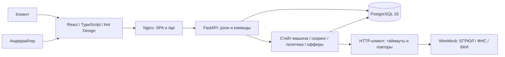

# Архитектура реализации

Исходные C4: [контекст](design/c4/c4-l1-context.png), [контейнеры](design/c4/c4-l2-containers.png). Процесс: [BPMN TO BE](design/bpmn-to-be.bpmn). Система остаётся модульным монолитом.

Docker Compose запускает web, api, db, mocks. Зависимости ожидаются по healthcheck. Nginx раздаёт SPA и проксирует относительный /api/v1; Vite использует dev proxy. Прямой переход на /applications/ID и /bank/ID поддержан.

Роутеры проверяют роль; services выполняют сценарии, domain содержит переходы и чистые функции evaluate/apply_policy. Мапперы вычисляют availableActions на сервере. Сервис проверяет каждую команду независимо от UI.

Подача берёт SELECT FOR UPDATE, валидирует анкету, записывает все переходы, до 9 ограниченных HTTP-попыток, снимки и решение в одной транзакции. Ошибка откатывает транзакцию. Ожидаемая недоступность источника сохраняется и отправляет заявку специалисту. Долгих задач после ответа нет.

Повторяемые команды с ключом берут PostgreSQL advisory lock для пользовательского ключа и блокировку заявки. Успешный ответ и побочные эффекты коммитятся вместе. UNIQUE(user_id, operation_code, key_code) и UNIQUE(disbursement.application_id) защищают ограничения на уровне БД.

Миграция 0002 дополняет исходную модель двумя техническими сущностями. Миграция 0001 и исходные диаграммы не переписывались. Все интеграции локальные; сеть нужна при первоначальной сборке образов и установке зависимостей.
