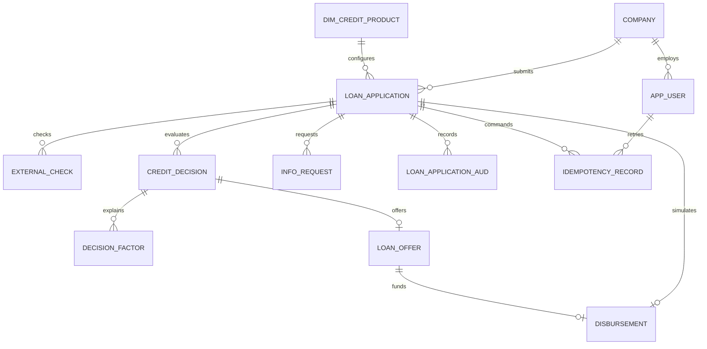

# Модель данных

Исходная модель: [словарь](../data-dictionary.md), [draw.io](../data-model.drawio). Бизнес-сущности сохранены. Миграция 0002 добавляет:

- idempotency_record: record_id, user_id, application_id, operation_code, key_code, request_hash_code, response_cval, create_dttm. UNIQUE(user_id, operation_code, key_code).
- disbursement: disbursement_id, application_id, offer_id, amount_amt, create_dttm. UNIQUE(application_id). Только симуляция выдачи.

AUTO-комментарий credit_decision содержит JSON-снимок правил и входов. decision_factor.factor_cval содержит JSON со значением и объяснением; старые строковые факторы также читаются. external_check фиксирует каждую попытку, время и статус. Клиенту эти внутренние данные не выдаются. Изменение статуса и запись аудита атомарны; аудит защищён исходными триггерами от UPDATE/DELETE/TRUNCATE.
