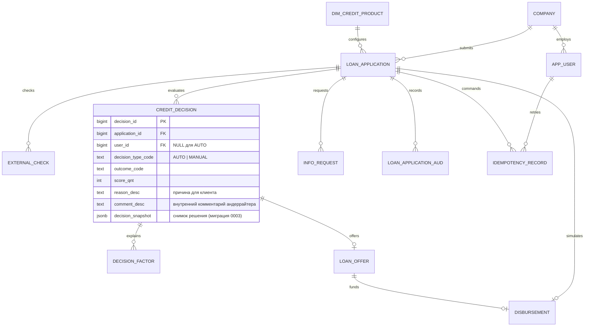

# Модель данных

Исходная модель: [словарь](design/data-dictionary.md), [draw.io](design/data-model.drawio). Бизнес-сущности сохранены. Миграция 0003 добавляет `credit_decision.decision_snapshot` (JSONB, nullable): структурированный снимок решения. Бэкфилл: у AUTO-решений JSON из `comment_desc` переносится в `decision_snapshot`, `comment_desc` становится NULL; битый JSON остаётся в `comment_desc`. Миграция 0002 добавляет:

- idempotency_record: record_id, user_id, application_id, operation_code, key_code, request_hash_code, response_cval, create_dttm. UNIQUE(user_id, operation_code, key_code).
- disbursement: disbursement_id, application_id, offer_id, amount_amt, create_dttm. UNIQUE(application_id). Только симуляция выдачи.

Снимок решения лежит в `credit_decision.decision_snapshot`: версия политики, `asOfDate`, входы с источниками (EGRUL/FNS/BKI/CLIENT) и статусом, внешние проверки, факторы с `maxPoints`, балл, пороги, правило, лимит с расчётом, разложение ставки; у ручного решения — кто решил, комментарий, ставка, превышение лимита. `comment_desc` хранит только внутренний комментарий андеррайтера. Целиком конфиг в снимок не пишется. decision_factor.factor_cval содержит JSON со значением и объяснением; старые строковые факторы также читаются. external_check фиксирует каждую попытку, время и статус. Клиенту эти внутренние данные не выдаются. Изменение статуса и запись аудита атомарны; аудит защищён исходными триггерами от UPDATE/DELETE/TRUNCATE.

Сессия 2. Миграция 0004: `loan_offer.valid_until_dttm` и `info_request.due_dttm` (timestamptz, NULL для старых строк; срок = момент создания + `OFFER_TTL_DAYS` / `INFO_REQUEST_TTL_DAYS`). Новые статусы в `dim_application_status`: `WITHDRAWN` («Заявка отозвана») и `EXPIRED` («Срок истёк»), оба конечные; переходы описаны в [state-machine.md](state-machine.md). Новая таблица не нужна: правила подбора продукта лежат в `backend/app/domain/recommendation.yaml`, а не в БД.
