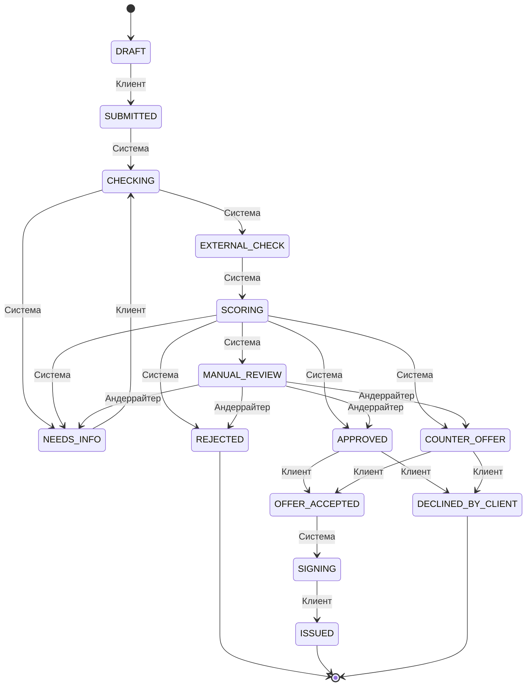

# Стейт-машина заявки

Документ сгенерирован из таблицы `TRANSITIONS` в `backend/app/domain/state_machine.py`:
`uv run python -m app.scripts.export_state_machine`. Руками не править: тест сверяет файл с кодом.
Любой переход, которого нет в таблице, API отклоняет ответом 409 `INVALID_TRANSITION`.
Каждый переход пишет строку в `loan_application_aud` в той же транзакции.

## Статусы

| Код | Название для клиента | Конечный |
|---|---|---|
| `DRAFT` | Черновик | нет |
| `SUBMITTED` | Подана | нет |
| `CHECKING` | Проверяем заявку | нет |
| `EXTERNAL_CHECK` | Получаем данные из внешних сервисов | нет |
| `SCORING` | Оцениваем заявку | нет |
| `NEEDS_INFO` | Нужны данные | нет |
| `MANUAL_REVIEW` | На рассмотрении у специалиста | нет |
| `APPROVED` | Одобрено | нет |
| `COUNTER_OFFER` | Встречное предложение | нет |
| `REJECTED` | Отказ | да |
| `OFFER_ACCEPTED` | Предложение принято | нет |
| `SIGNING` | Подписание | нет |
| `ISSUED` | Кредит выдан | да |
| `DECLINED_BY_CLIENT` | Вы отказались | да |

## Переходы

| Из | В | Кто инициирует | Условие |
|---|---|---|---|
| `DRAFT` | `SUBMITTED` | Клиент | Заполнены сумма, срок и цель; значения в диапазоне продукта |
| `SUBMITTED` | `CHECKING` | Система | Заявка принята конвейером обработки |
| `CHECKING` | `NEEDS_INFO` | Система | Не хватает обязательных данных анкеты |
| `CHECKING` | `EXTERNAL_CHECK` | Система | Данных достаточно |
| `NEEDS_INFO` | `CHECKING` | Клиент | Клиент дозаполнил запрошенные поля |
| `EXTERNAL_CHECK` | `SCORING` | Система | Внешние сервисы ответили |
| `SCORING` | `APPROVED` | Система | Балл не ниже порога одобрения, сумма в пределах лимита |
| `SCORING` | `COUNTER_OFFER` | Система | Балл не ниже порога одобрения, запрошенная сумма выше лимита |
| `SCORING` | `NEEDS_INFO` | Система | Для оценки не хватает данных |
| `SCORING` | `MANUAL_REVIEW` | Система | Балл в пограничной зоне |
| `SCORING` | `REJECTED` | Система | Сработал стоп-фактор или балл ниже порога отказа |
| `MANUAL_REVIEW` | `APPROVED` | Андеррайтер | Решение андеррайтера с комментарием |
| `MANUAL_REVIEW` | `COUNTER_OFFER` | Андеррайтер | Решение андеррайтера с комментарием и новой суммой |
| `MANUAL_REVIEW` | `NEEDS_INFO` | Андеррайтер | Решение андеррайтера с комментарием и списком полей |
| `MANUAL_REVIEW` | `REJECTED` | Андеррайтер | Решение андеррайтера с комментарием |
| `APPROVED` | `OFFER_ACCEPTED` | Клиент | Клиент принял оффер |
| `APPROVED` | `DECLINED_BY_CLIENT` | Клиент | Клиент отказался от оффера |
| `COUNTER_OFFER` | `OFFER_ACCEPTED` | Клиент | Клиент принял встречное предложение |
| `COUNTER_OFFER` | `DECLINED_BY_CLIENT` | Клиент | Клиент отказался от встречного предложения |
| `OFFER_ACCEPTED` | `SIGNING` | Система | Подготовлено подписание |
| `SIGNING` | `ISSUED` | Клиент | Код подписи подтверждён |

## Диаграмма

