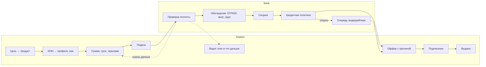
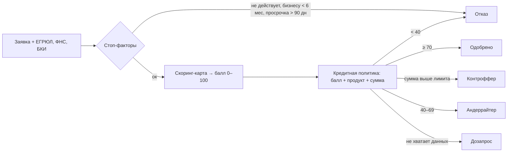
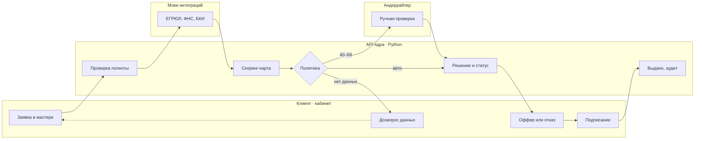

# Конспект первого созвона · Альфа Хак

Кейс «Умный кредитный кабинет предпринимателя». Созвон 20 октября 2026.
Команда: Маша, Никита, Миша. Конспект идёт по слайдам презентации.

> Цель созвона: за час договориться о скоупе, стеке, ролях и часах, чтобы завтра уже писать код.
> **Решено заранее:** играем на победу; активно используем нейронки, поэтому оценки на код поделены на два; бэкенд на Python; **Must готов утром 23.10.**

---

## 1. Сроки и формат (слайд 26)

- **26.10 в 18:00 МСК — дедлайн онлайн-тура, это отбор.** Результаты 17.11, доработка 17–27.11, финал в Москве 28–29.11 (поездку оплачивает банк).
- Сначала надо пройти отбор с рабочим сквозным сценарием и хорошей документацией. Но раз играем на победу, свободное время тратим на уровни развития (раздел 11).
- Сдаём **ссылку на репозиторий**, можно ещё документ с материалами. Жюри нужен доступ на чтение и клонирование (аккаунт `alfa-hack-2026`, если репозиторий приватный).
- Коммиты после дедлайна не учитываются.
- Презентация в отборе не нужна. Демо-видео по желанию, но мы его запишем как страховку.

## 2. Что от нас хотят (слайды 2–4)

Прототип кредитного конвейера для малого бизнеса: клиент проходит путь от потребности до решения, а банк ведёт заявку в том же продукте. Это должна быть работающая система, а не набор экранов.

**Критерии жюри и что они значат для нас:**

| Критерий | Что делаем |
|---|---|
| Целостность | Один сквозной путь от выбора продукта до «выдано» без заглушек |
| Готовность к проверке | Жюри делает `docker compose up`, входит тестовым аккаунтом и идёт по README |
| UX | Клиент без банковской экспертизы понимает статус и следующий шаг |
| Согласованность модулей | Данные вводятся один раз; статус меняется строго по стейт-машине |
| Enterprise | Роли, аудит-лог, миграции, OpenAPI, таймауты к интеграциям, тесты |
| Потенциал развития | Решения обоснованы исследованием, понятно, как масштабировать |

**Жёсткие рамки:**
- Всё запускается в Docker одной командой, версии зафиксированы lock-файлами.
- Ничего платного: никаких платных API, подписок и лицензий.
- Данные только синтетические.
- Никаких систем банка: ЕГРЮЛ, ФНС и БКИ делаем как локальные моки.
- Сценарий целиком внутри продукта, без email, SMS и мессенджеров.
- Только веб, мобильное приложение не принимается.
- LLM только с открытыми весами. ИИ не обязателен, ключей не дают, и сам по себе он баллов не добавляет.
- ПК жюри: 8–16 ГБ ОЗУ, без видеокарты.

## 3. Честная оценка (слайд 5)

- **Сильные стороны:** фронт и дизайн делает Маша, а она сама бэкендер, поэтому стык с API не развалится. Миша закрывает исследование и документацию, а это два критерия из шести.
- **Главный риск — переоценить ускорение от нейронок.** Они ускоряют написание кода, но не отладку и стыковку модулей. Ядро у Никиты, а часов у него меньше всех, так что это по-прежнему критический путь.
- **Главная ловушка:** микросервисы, Kafka, Keycloak, LLM в основном сценарии. Запуск одной командой важнее красоты архитектуры.

## 4. Скоуп MVP (слайд 6)

**Must, без этого не сдаём:**
- Вход тестовыми аккаунтами: клиент и сотрудник банка. Регистрацию не делаем, это разрешено.
- Профиль компании по ИНН из мока ЕГРЮЛ.
- 3 продукта (оборотный кредит, кредит на оборудование, овердрафт) как конфигурация и один общий мастер заявки с черновиком.
- Проверка полноты, обогащение из моков БКИ и ФНС, скоринг.
- 5 исходов решения: одобрено, контрпредложение, нужны данные, ручная проверка, отказ.
- Панель банка на одну страницу: очередь и кнопки решения.
- Таймлайн статуса, оффер, подписание (симуляция), «выдано».
- Аудит всех переходов заявки.

**Уровни развития** (по плану из раздела 11, только после рабочего Must): подбор продукта и причина решения; сотрудники компании и выписка; дашборд, деплой, ИИ-помощник.

**Не делаем:** уведомления, документы и ЭЦП, реальные интеграции, мобильное приложение, email и SMS.

## 5. Процесс заявки (слайд 7)

`Черновик → Подана → Проверка полноты → Обогащение (ЕГРЮЛ, БКИ) → Скоринг и решение`

Исходы: **одобрено** (оффер) · **контрпредложение** (другая сумма или срок) · **нужны данные** (возврат клиенту) · **ручная проверка** (андеррайтер в панели) · **отказ** (с понятной причиной).

После одобрения: `Оффер принят → Подписание (симуляция) → Выдано`.

## 6. Логика продукта (слайды 8–10)

### 6.1 Путь клиента и работа банка

Два принципа: **данные вводятся один раз** и дальше переиспользуются; **клиент всегда видит статус** и свой следующий шаг.

### 6.2 Как принимается решение

- Скоринг-карта: возраст бизнеса, выручка, долговая нагрузка, кредитная история, отрасль.
- Скоринг (оценка риска) и кредитное решение (политика банка поверх скоринга) разделены, кейс на этом настаивает.
- Пороги и веса — черновик, финализирует Миша к вечеру 21.10. Они лежат в конфиге, и в карточке заявки видно, какие факторы дали балл.

### 6.3 Пять сценариев для демо

| Сценарий | Компания | Путь |
|---|---|---|
| Быстрое одобрение | ИП, оборудование, 1,5 млн | Заявка → балл 82 → одобрено → подписание → выдано |
| Контроффер | ООО, оборотка, 10 млн | Балл 64 → выше лимита → предложение 6 млн → клиент принимает |
| Ручная проверка | Молодое ООО, хорошая выручка | Балл 55 → очередь → андеррайтер → оффер с комментарием |
| Дозапрос данных | Нет выручки за год | Проверка → нужны данные → клиент дополнил → повторный скоринг |
| Отказ | Просрочка 120 дней | Заявка → стоп-фактор → отказ с понятной причиной |

Каждый сценарий — своя синтетическая компания, тестовый аккаунт и тест-сценарий в README. Цифры условные.

## 7. Архитектура (слайды 11–12)

Модульный монолит, всё в `docker compose`:
- **Веб (React SPA):** кабинет клиента и панель банка в одном приложении, разные роли.
- **API ядра (Python, FastAPI, OpenAPI):** заявки и стейт-машина, продукты, проверки и обогащение, скоринг и решение, очередь андеррайтера, роли и аудит.
- **PostgreSQL:** данные, аудит, миграции.
- **Мок-интеграции:** ЕГРЮЛ, ФНС, БКИ отдельным контейнером на WireMock.
- **Открытая LLM:** опционально, вне Docker, основной сценарий работает без неё.

Плюсы для оценки за enterprise: healthchecks, seed-данные при старте, таймауты и ретраи к интеграциям, идемпотентная подача заявки, клиент для фронта генерируется из OpenAPI.

**Стек решён:** бэкенд на Python 3.12 + FastAPI, SQLAlchemy 2 и Alembic, Pydantic v2, pytest, зависимости в `uv.lock`. Фронт: React + TypeScript + Ant Design.

### 7.1 BPMN-схема: кто что делает (слайд 12)

Каждая стрелка — переход стейт-машины и запись в аудит. Полную BPMN для README Миша рисует в bpmn.io или draw.io по этой схеме.

## 8. Роли (слайды 13–14)

| Кто | Зона | Часы на Must |
|---|---|---|
| **Маша** | Фронт и дизайн в коде, репозиторий и compose, API банка (очередь и ручное решение) | ≈22 |
| **Никита** | Ядро бэкенда и техлид: контракт OpenAPI, модель данных, стейт-машина, движок решения, роли и аудит | ≈17 |
| **Миша** | Исследование, процесс и правила решения, моки без кода, синтетика, документация, финальная проверка и демо-видео | ≈19 |

- Работа распределена по часам: у Маши времени больше всех, поэтому на неё перенесены compose и API банка.
- Миша снимает рутину с Никиты: моки как JSON-стабы, скоринг-карта как таблица-конфиг, Postman-коллекция.
- **Страховка:** в четверг вечером проверяем, готово ли ядро. Если отстаёт, Маша забирает движок решения.
- **Предложение:** владелец сдачи — Миша. В понедельник он не пишет код и спокойно прогоняет всё глазами жюри.

### 8.1 Стиль дизайна: пять мудбордов (слайды 15–16)

| Стиль | Как выглядит | Плюс | Минус |
|---|---|---|---|
| 1. Альфа-нативный | Белый, красный #EF3124, строгая сетка, Onest | Жюри видит «свой» продукт, готовый к внедрению | Легко выглядеть шаблоном |
| 2. Финтех-минимализм | Stripe/Linear: воздух, серый, индиго, Inter | Самый быстрый в вёрстке | Не про Альфу |
| 3. Тёплый и дружелюбный | Бежевый, жёлтый, большие скругления, Nunito | Снимает страх «кредит — это сложно» | Нужны иллюстрации, риск несерьёзности |
| 4. Тёмный премиум | Ночной фон, фиолетовый и бирюзовый, Manrope | Вау на демо, хорош для панели банка | Хуже читается клиенту |
| 5. Необрутализм | Жирные рамки, жёсткие тени, яркие плашки, Rubik | Запоминается | Спорно для банка |

- **Рекомендация:** Альфа-нативный для кабинета клиента, тёмный акцент только в панели банка. Своё лицо даём через понятность (таймлайн статуса, причина решения).
- Любой стиль — это тема Ant Design (цвета, радиусы, шрифт), 1–2 часа.
- **Сильный ход:** открытая библиотека компонентов Альфы core-components (GitHub alfa-laboratory) вместо Ant Design, если подойдёт лицензия. Проверить лицензию до перехода и внести в THIRD_PARTY_NOTICES; если переход дороже двух часов, остаёмся на Ant Design.
- Стиль замораживаем после четверга.

## 9. Задачи и оценки (слайды 17–19)

Часы с нейронками (исходная оценка поделена на два). Интервью, проверку с чистой машины и видео не делили: их нейронки почти не ускоряют.

**Маша · 22 ч**
- [ ] Репозиторий, docker compose, Postgres, миграции — 2 ч, к 20.10
- [ ] Каркас фронта, тема Ant Design, вход, клиент из OpenAPI — 4 ч, к 21.10
- [ ] Кабинет: каталог продуктов и мастер заявки с черновиком — 5 ч, к 22.10
- [ ] Кабинет: таймлайн статуса, оффер, подписание, запрос данных — 4 ч, к 22.10
- [ ] API банка: очередь, ручное решение, запрос данных — 3 ч, к 22.10
- [ ] Панель банка на одну страницу — 2 ч, к 22.10
- [ ] Образ фронта, полировка, фиксы после сквозного теста — 2 ч, к 25.10

**Никита · 17 ч**
- [ ] Контракт OpenAPI и модель данных — 3 ч, к 21.10
- [ ] API заявок, стейт-машина, валидация, черновики — 5 ч, к 22.10
- [ ] Движок решения: скоринг-карта из конфига и политика — 3 ч, к 22.10
- [ ] Клиент к мокам интеграций с таймаутами и ретраями — 2 ч, к 22.10
- [ ] Роли и аудит-лог — 2 ч, к 22.10
- [ ] Seed-данные при старте и базовые тесты — 2 ч, к 22.10

**Миша · 19 ч**
- [ ] Два коротких интервью с предпринимателями, JTBD, CJM — 3 ч, к 21.10
- [ ] Модель процесса, правила решения, сценарии экранов для Маши — 3 ч, к 21.10
- [ ] Моки ЕГРЮЛ, ФНС, БКИ как WireMock-стабы — 2 ч, к 21.10
- [ ] Синтетические компании под 5 исходов, тестовые аккаунты — 2 ч, к 22.10
- [ ] README, диаграммы, тест-сценарии, Postman, THIRD_PARTY_NOTICES — 5 ч, к 25.10
- [ ] Проверка с чистой машины и тег релиза — 2 ч, к 26.10
- [ ] Демо-видео основного сценария — 2 ч, к 26.10

## 10. Ёмкость (слайд 20)

- На Must нужно **58 ч**, доступно **≈110 ч** (допущение: Маша ~50, Никита и Миша по ~30). Свободно около **50 ч**.
- Половину свободного времени считаем уходящей на отладку и стыковку, остальное идёт в уровни развития.
- Ускорение ×2 — это ставка. **Проверяем её в четверг утром:** если ходячего скелета нет, Must к утру 23.10 под угрозой,, план развития откладываем и живём по исходным оценкам.
- **На созвоне каждый называет честное число часов по дням до 26.10.**

## 11. План развития: что делаем, если успеваем раньше (слайд 22)

| Когда готово | Что делаем | Часы | Зачем |
|---|---|---|---|
| **Must готов к пт утру** | Подбор продукта по цели («на что нужны деньги» → продукт); причина решения простым языком | ≈8 | UX: клиент без экспертизы понимает, что ему подходит и почему |
| **Готово к сб утру** | Несколько сотрудников одной компании с ролями (директор, бухгалтер); загрузка выписки CSV → выручка в скоринг | ≈12 | Целевая аудитория из кейса, меньше ручного ввода |
| **Готово к вс утру** | Дашборд банка (воронка, доля автоодобрений, время решения); деплой и ИИ по меню плюшек (11.1) | ≈14 | Enterprise и потенциал развития |
| **Вс 14:00 в любом случае** | Feature freeze: только фиксы, документация, демо-видео, проверка с чистой машины | — | Готовность к проверке |

- **Правило входа:** следующий уровень открываем, только когда весь предыдущий проходит сквозной тест в чистом compose. Если отстаём от плана, уровни пропускаем, а Must не трогаем.
- ИИ-помощник строго опциональный: основной сценарий проходит без него, у жюри нет видеокарты, значит модель маленькая (3–7B, квантованная).
- Уведомления, документы и ЭЦП переносим на доработку к финалу в ноябре.

### 11.1 Меню плюшек после Must (слайд 23)

Порядок в таблице и есть рекомендуемая очередь. Часы с учётом нейронок.

| Плюшка | Что даёт | Часы | Риск и как снижаем |
|---|---|---|---|
| 1. CI и тесты | Готовность к проверке: сборка и тесты на каждый пуш | 2 | Почти нулевой, GitHub Actions |
| 2. Причина решения | UX: клиент видит, почему отказ или контроффер | 3 | Шаблоны по факторам скоринга, без ИИ |
| 3. Дашборд банка | Enterprise: воронка, доля автоодобрений, время решения | 4 | Только графики из готовых данных |
| 4. Выписка CSV | Меньше ручного ввода: выручка сама в скоринг | 4 | Один формат файла, синтетика |
| 5. Деплой в прод | Жюри кликает по ссылке без Docker; пригодится на финале | 3 | VPS на время отбора; проверка всё равно по compose |
| 6. Наблюдаемость | Enterprise: health, логи с id заявки, метрики | 2 | Без Grafana, только эндпоинты |
| 7. ИИ-помощник | Объясняет решение, заполняет заявку из текста; сам по себе очков не даёт | 6 | Опционально, вне Docker; без модели работает шаблон |

**Если ИИ, то** Qwen3-4B-Instruct (Apache 2.0, хороший русский) в квантовании Q4 через Ollama: около 3 ГБ памяти, работает на CPU. Для слабого ПК — Qwen3-1.7B. Модели 7–8B (например, T-lite) на ПК жюри с 8 ГБ будут отвечать слишком медленно. Ключей организаторы не дают, ИИ баллов сам по себе не добавляет, поэтому он последний в очереди.

## 12. Таймлайн (слайд 21)

| День | Что |
|---|---|
| Вт 20 | Решения на созвоне, репозиторий, черновик процесса |
| Ср 21 | **Веха к обеду:** контракт OpenAPI, процесс и правила решения заморожены. Дальше ядро и экраны |
| Чт 22 | **Веха утром:** ходячий скелет в compose («создал заявку → увидел статус»), проверяем ставку на нейронки. Весь день добиваем Must |
| Пт 23 | **Веха утром:** Must готов и проходит сквозной тест. Дальше уровни развития |
| Сб 24 | Уровни развития по плану |
| Вс 25 | Уровни до обеда, **14:00 feature freeze**, дальше тесты, документация, видео |
| Пн 26 | Только фиксы и README. **16:00 тег релиза**, **18:00 дедлайн** |

С 22.10 каждый вечер собираем всё с нуля в чистом окружении.

## 13. Чек-лист сдачи (слайд 24)

- [ ] GitHub с историей коммитов, доступ для `alfa-hack-2026`, тег версии — Маша (репо), Миша (тег)
- [ ] Запуск одной командой в Docker, lock-файлы — Маша
- [ ] OpenAPI/Swagger и коллекция запросов — Никита, Миша
- [ ] Синтетические данные и тестовые аккаунты — Миша
- [ ] Архитектурная схема, диаграмма состояний, модель данных — Миша
- [ ] README: назначение, архитектура, запуск, переменные окружения, сценарий проверки — Миша
- [ ] Тестовые сценарии — Миша
- [ ] THIRD_PARTY_NOTICES — Миша
- [ ] Демо-видео — Миша
- [ ] Ссылка на репозиторий загружена на платформу до 18:00 26.10 — Миша

## 14. Риски (слайд 25)

| Риск | Что делаем |
|---|---|
| Ядро бэкенда не успевает | Миша снимает моки и конфиги; проверка в чт вечером; при отставании Маша берёт движок решения |
| Переоценили ускорение от нейронок | Проверка в чт утром: нет скелета — уровни развития откладываем, Must не трогаем |
| Жюри не запустит | Сборка с нуля каждый вечер; Миша проверяет по README как жюри; демо-видео как страховка |
| Модули не стыкуются | Контракт OpenAPI в среду к обеду, фронт на моках из него |
| Дедлайн в рабочий понедельник | Всё критичное до вечера воскресенья |
| Фичи раньше Must | Уровень открываем только после сквозного теста предыдущего |

## 15. Повестка на 60 минут (слайд 27)

1. **0–5.** Цель — победа: часы каждого, ставка на нейронки.
2. **5–15.** Кейс, критерии, логика продукта.
3. **15–30.** Скоуп, стиль дизайна и плюшки.
4. **30–45.** Роли, оценки, таймлайн и план развития: принимаем или правим.
5. **45–55.** Процессы: репозиторий, трекер, ежедневный апдейт, ревью.
6. **55–60.** Ответы организаторов и задачи до завтрашнего вечера.

**До вечера 21.10:** Маша — репозиторий, compose, каркас фронта; Никита — контракт OpenAPI и модель данных; Миша — процесс, правила решения, моки, интервью.

Ещё: посмотреть запись Q&A-вебинара по кейсу от 20.10, там отвечали про критерии оценки.

---

## Решения созвона

*Заполняем по ходу созвона.*

| Вопрос | Решение |
|---|---|
| Цель: победа или опыт | **Победа** |
| Скорость работы | **Активно используем нейронки, оценки на код делим на два** |
| Язык и фреймворк бэкенда | **Python** (по умолчанию FastAPI) |
| Срок Must | **Утро 23.10** |
| Стиль дизайна | — (рекомендация: Альфа-нативный) |
| Продукты в MVP | — |
| Владелец сдачи | — |
| Часы каждого по дням до 26.10 | — |
| Трекер задач и рабочий чат | — |
| Время ежедневного 15-минутного синка | — |

## Открытые вопросы

- Критерии оценки: что сказали на Q&A-вебинаре 20.10?
- Можно ли после 18:00 26.10 править README и документацию?
